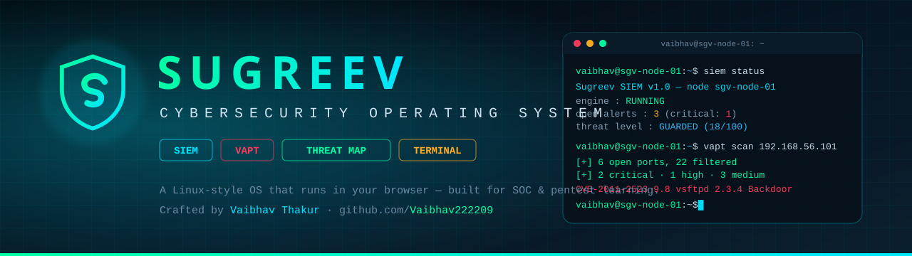
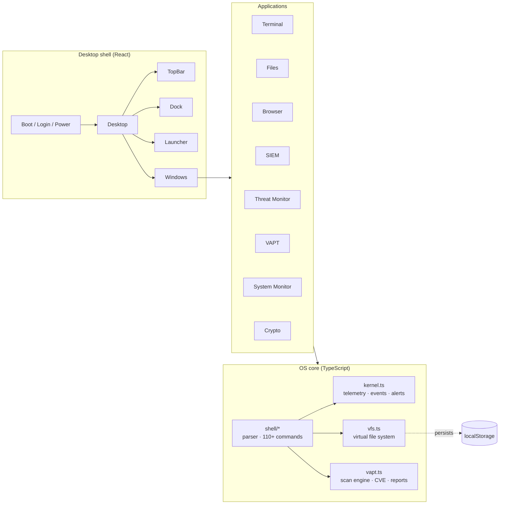
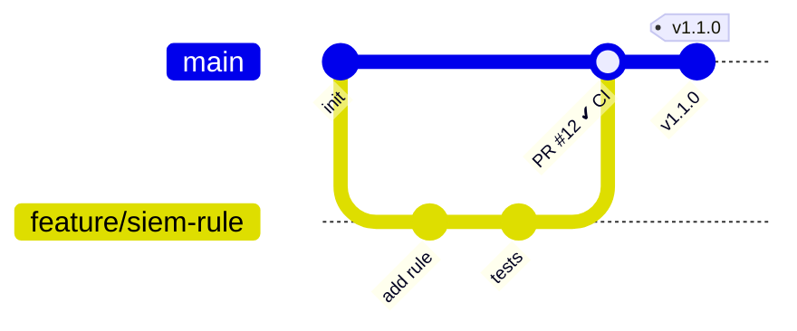

<div align="center">



<br/>

[](https://github.com/Vaibhav222209/Sugreev-OS/actions/workflows/ci.yml)
[](https://github.com/Vaibhav222209/Sugreev-OS/actions/workflows/deploy-pages.yml)
[](LICENSE)
[](https://github.com/Vaibhav222209/Sugreev-OS/stargazers)


### 🛡️ A Linux-style cybersecurity operating system that runs entirely in your browser.
**SIEM · VAPT · Live Threat Map · Real Shell · Virtual File System**

[**🚀 Live Demo**](https://vaibhav222209.github.io/Sugreev-OS/) &nbsp;•&nbsp;
[**📖 User Guide**](docs/USER_GUIDE.md) &nbsp;•&nbsp;
[**⌨️ Command Reference**](docs/COMMANDS.md) &nbsp;•&nbsp;
[**🏗️ Architecture**](docs/ARCHITECTURE.md) &nbsp;•&nbsp;
[**🤝 Contribute**](CONTRIBUTING.md)

</div>

---

## 📑 Table of contents

- [✨ What is Sugreev OS?](#-what-is-sugreev-os)
- [🚀 Quick start — steps to open](#-quick-start--steps-to-open)
- [🧭 Your first 5 minutes](#-your-first-5-minutes)
- [🧩 Applications](#-applications)
- [⌨️ Terminal highlights](#️-terminal-highlights)
- [🏗️ Architecture & project structure](#️-architecture--project-structure)
- [🔁 Workflow (Git + CI/CD)](#-workflow-git--cicd)
- [🧪 Testing](#-testing)
- [⚖️ Ethics & simulation notice](#️-ethics--simulation-notice)
- [🗺️ Roadmap](#️-roadmap)
- [👨‍💻 Author](#-author)

---

## ✨ What is Sugreev OS?

> *Sugreev* is the vanara king who guarded the kingdom of **Kishkindha** in the Ramayana.
> **Sugreev OS 1.0 "Kishkindha"** guards *your* learning journey in blue-team and red-team security.

Sugreev OS is a **full desktop operating-system experience** — boot sequence, login, windowed desktop, dock, top bar, terminal, file manager, browser — wrapped around a **cybersecurity lab**:

| 🔵 Blue team (defend) | 🔴 Red team (assess) |
|---|---|
| Live **SIEM** with event stream, alert triage, MITRE ATT&CK heat-map | **VAPT lab** — port scan, service fingerprinting, CVE correlation, CVSS scoring |
| **Threat monitor** with animated global attack map, IDS/IPS status, firewall blocklist | **Web-app audit** — headers, SQLi, XSS, exposed `.git`, CORS, TLS |
| **Auto-response** engine that blocks IPs behind critical events | **Exploit catalogue** mapped to every finding (reference only) |
| Detection rules, response playbooks, IOC feed | One-click **Markdown pentest report** |

Everything is **100 % client-side** — no backend, no database, no real network traffic. Open one HTML file and you have a SOC in a tab.

### Highlights

- 🖥️ **Real OS feel** — BIOS/GRUB boot log, login & lock screen, draggable / resizable / maximisable windows, notifications, context menu
- 📌 **Taskbar on top, dock on the side** — never at the bottom, exactly like GNOME-style desktops
- ⚡ **Power options** — Lock · Log out · Restart · Shut down (with animated shutdown sequence and a power-on button)
- 🧠 **Live kernel simulation** — per-core CPU, frequencies, temperature, memory, disk and network all move in real time
- ⌨️ **sgsh shell** with pipes, redirects, `&&`, globbing, `$VARS`, scripts, `sudo`, tab-completion & history
- 🎨 **Cyber-aesthetic** — glassmorphism, neon accents (6 colour themes), Matrix-rain / Neon-grid / Aurora wallpapers, CRT scanlines
- 💾 **Persistent virtual file system** — saved to `localStorage`, with Linux-style permissions

---

## 🚀 Quick start — steps to open

### Option A — Use it online (zero install)

1. Open **https://vaibhav222209.github.io/Sugreev-OS/**
2. Watch the boot sequence *(click or press any key to skip)*
3. Log in as **Vaibhav Thakur** — password: **`sugreev`**
4. Welcome to the desktop 🎉

### Option B — Run locally (development)

```bash
# 1. Clone
git clone https://github.com/Vaibhav222209/Sugreev-OS.git
cd Sugreev-OS

# 2. Install (Node.js 20+ recommended)
npm install

# 3. Start the dev server
npm run dev
```

Then open **http://localhost:5173** in your browser and log in with password **`sugreev`**.

### Option C — Build a single portable file

```bash
npm run build
```

Vite bundles the whole OS into **one self-contained file**: `dist/index.html`.
Double-click it to run Sugreev OS offline, host it on any static server, or drop it on a USB stick.

> 💡 Fonts load from Google Fonts when online; offline the OS gracefully falls back to system monospace fonts.

### Requirements

| Tool | Version |
|---|---|
| Node.js | 20 or newer |
| npm | 10 or newer |
| Browser | Any modern Chromium, Firefox or Safari |

---

## 🧭 Your first 5 minutes

| Step | Do this | You will see |
|---|---|---|
| 1️⃣ | Log in (`sugreev`) | Desktop with Matrix rain, top bar, left dock, live widget |
| 2️⃣ | In the **Terminal** run `neofetch` | System banner with live threat level |
| 3️⃣ | Run `siem status` then `siem tail -f` | Streaming security logs — press **Ctrl+C** to stop |
| 4️⃣ | Click the **Threat Monitor** dock icon | Animated attack arcs hitting your node |
| 5️⃣ | Run `vapt scan 192.168.56.101` | 5-phase scan, CVEs, CVSS and risk score |
| 6️⃣ | Run `vapt report` → `edit ~/Reports/` | Auto-generated pentest report |
| 7️⃣ | Open **SIEM Console → Alerts**, click an alert → **Block IP** | Alert flips to *blocked*, firewall rule created |
| 8️⃣ | Top-right avatar → **Shut down** | Animated shutdown & a power-on button |

---

## 🧩 Applications

| App | What it does |
|---|---|
| 🖥️ **Terminal** | `sgsh` shell with **110+ commands** — files, networking, security, system and fun. Pipes, redirects, scripts, tab-complete. |
| 📁 **Files** | Grid/list file manager with places sidebar, breadcrumbs, create / rename / delete, hidden files, permissions & ownership. |
| 🌐 **Browser** | Tabbed sandboxed browser. Internal pages (`sugreev://home`, `cve`, `docs`, `about`) + iframe for external sites. |
| 📊 **SIEM Console** | Dashboard (EPS, severity, MITRE coverage, top attackers), Live Logs with filters/pause, Alert triage with playbooks, Detection rules. |
| 🛰️ **Threat Monitor** | Animated global attack map, threat gauge, active threats, firewall blocklist, defence engines, IOC feed, auto-response toggle. |
| 🎯 **VAPT Lab** | Scanner (quick/full/stealth), expandable CVE findings with fixes, web audit, exploit database, one-click Markdown report. |
| 📈 **System Monitor** | Per-core CPU graphs & frequencies, memory, storage, network, temperature, process table with *kill*, hardware & CPU flags. |
| 🔐 **Crypto Toolkit** | Base64 / hex / URL / ROT13, MD5 + SHA-1/256/384/512, password auditor & generator, JWT decoder. |
| ✏️ **Editor** | Line-numbered editor with Ctrl+S, Save As, Markdown preview. |
| ⚙️ **Settings** | Accent colour, wallpaper, scanlines, animations, auto-block policy, reset file-system. |

---

## ⌨️ Terminal highlights

Type `help` for the full list (grouped by category) or `man <command>`.

```console
vaibhav@sgv-node-01:~$ neofetch
vaibhav@sgv-node-01:~$ siem alerts 5
vaibhav@sgv-node-01:~$ siem tail -f                      # live log stream
vaibhav@sgv-node-01:~$ sudo siem block 185.220.101.4     # firewall response
vaibhav@sgv-node-01:~$ threats                           # live threat summary
vaibhav@sgv-node-01:~$ nmap -sV -A 192.168.56.101        # simulated service scan
vaibhav@sgv-node-01:~$ vapt scan sugreev.local           # hardened host
vaibhav@sgv-node-01:~$ vapt scan 10.10.10.5 --profile stealth
vaibhav@sgv-node-01:~$ vapt report                       # → ~/Reports/*.md
vaibhav@sgv-node-01:~$ searchsploit apache               # exploit modules
vaibhav@sgv-node-01:~$ cve log4j                         # CVE lookup
vaibhav@sgv-node-01:~$ cat /var/log/auth.log | grep Failed | wc -l
vaibhav@sgv-node-01:~$ sha256sum README.md && base64 notes.txt
```

| Category | Commands |
|---|---|
| 🛡️ **Security** | `siem` `threats` `vapt` `nmap` `nikto` `searchsploit` `cve` `hashid` |
| 🔥 **Firewall** | `iptables` `ufw` `fail2ban-client` |
| 🌐 **Network** | `ping` `traceroute` `whois` `dig` `nslookup` `curl` `wget` `ip` `ifconfig` `netstat` `ss` |
| 📂 **Files & text** | `ls` `cd` `cat` `cp` `mv` `rm` `mkdir` `touch` `find` `tree` `grep` `head` `tail` `wc` `sort` `uniq` `cut` `xxd` `stat` `chmod` `chown` `du` |
| ⚙️ **System** | `ps` `top` `kill` `free` `df` `lscpu` `lsblk` `lspci` `lsusb` `lsmod` `dmesg` `uname` `uptime` `systemctl` `journalctl` `apt` `sudo` `su` |
| 🔐 **Crypto** | `md5sum` `sha1sum` `sha256sum` `sha512sum` `base64` |
| 🖱️ **Desktop & power** | `open` `edit` `files` `browse` `lock` `logout` `reboot` `shutdown` |
| 🎮 **Fun** | `neofetch` `matrix` `hack` `cowsay` `fortune` `calc` |

📖 Full documentation: [`docs/COMMANDS.md`](docs/COMMANDS.md)

**Privilege model:** you are `vaibhav` (sudo group). Reading `/root` or `/etc/shadow`, `apt`, `siem block`, service restarts and writing to root-owned paths need `sudo` — just like Linux.

---

## 🏗️ Architecture & project structure



```text
Sugreev-OS/
├── .github/
│   ├── workflows/            # ci · deploy-pages · release · codeql
│   ├── ISSUE_TEMPLATE/       # bug report · feature request
│   ├── dependabot.yml
│   ├── CODEOWNERS
│   └── PULL_REQUEST_TEMPLATE.md
├── docs/
│   ├── assets/banner.svg
│   ├── ARCHITECTURE.md  COMMANDS.md  USER_GUIDE.md
├── src/
│   ├── App.tsx               # boot → login → desktop → power state machine
│   ├── apps/                 # Terminal, Files, Browser, Siem, ThreatMonitor, Vapt, ...
│   ├── components/           # TopBar, Dock, Launcher, WindowFrame, Wallpaper, ...
│   └── os/
│       ├── kernel.ts         # live telemetry + SIEM event/alert generator
│       ├── vfs.ts            # virtual file system (+ permissions, persistence)
│       ├── vapt.ts           # deterministic scan engine, CVE/exploit DB, reports
│       ├── hash.ts           # MD5, SHA, encoders, password entropy
│       ├── context.tsx       # OS API (openApp, notify, power, settings)
│       ├── registry.tsx      # application registry
│       └── shell/            # tokenizer, pipes, sys.ts, sec.ts, engine.ts
├── tests/                    # shell.smoke.ts (57 cases) · ui.smoke.tsx (25 checks, jsdom)
├── scripts/gen-commands.ts   # regenerates docs/COMMANDS.md
├── CONTRIBUTING.md  SECURITY.md  CODE_OF_CONDUCT.md  CHANGELOG.md  LICENSE
└── index.html  vite.config.ts  package.json
```

Deep dive → [`docs/ARCHITECTURE.md`](docs/ARCHITECTURE.md)

---

## 🔁 Workflow (Git + CI/CD)

### Development flow



1. **Fork** → create a branch `feature/<name>` or `fix/<name>`
2. Code, then run locally: `npx tsc --noEmit && npm run build`
3. Open a **Pull Request** — the template guides you
4. **CI** must pass (type-check · build · terminal smoke tests · CodeQL)
5. Merge to `main` → **GitHub Pages** redeploys automatically
6. Tag `vX.Y.Z` → **Release** workflow publishes a downloadable single-file build

### GitHub Actions

| Workflow | Trigger | What it does |
|---|---|---|
| [`ci.yml`](.github/workflows/ci.yml) | push / PR | `npm ci` → TypeScript check → production build → shell + UI smoke tests (Node 20 & 22) → uploads `dist` artifact |
| [`deploy-pages.yml`](.github/workflows/deploy-pages.yml) | push to `main` | Builds with `--base=./` and deploys to **GitHub Pages** |
| [`release.yml`](.github/workflows/release.yml) | tag `v*` | Builds and attaches `sugreev-os-<tag>.html` to a GitHub Release |
| [`codeql.yml`](.github/workflows/codeql.yml) | push / PR / weekly | CodeQL static analysis for JavaScript/TypeScript |
| [`dependabot.yml`](.github/dependabot.yml) | weekly | Keeps npm packages and Actions up to date |

**Enable Pages once:** *Repository → Settings → Pages → Build and deployment → Source: **GitHub Actions**.*

### Publish this project to your GitHub

```bash
git init
git add .
git commit -m "feat: Sugreev OS 1.0 Kishkindha"
git branch -M main
git remote add origin https://github.com/Vaibhav222209/Sugreev-OS.git
git push -u origin main
```

---

## 🧪 Testing

```bash
# type-check
npx tsc --noEmit

# production build
npm run build

# headless terminal smoke tests (57 commands, pipes, sudo, scans, reports…)
mkdir -p .tmp
npx esbuild tests/shell.smoke.ts --bundle --platform=node --format=esm --outfile=.tmp/shell.smoke.mjs
node .tmp/shell.smoke.mjs

# UI smoke tests in jsdom (boot → login → every app → lock → shutdown → power-on)
npx esbuild tests/ui.smoke.tsx --bundle --platform=node --format=esm --jsx=automatic --loader:.css=empty --external:jsdom --outfile=.tmp/ui.smoke.mjs
node .tmp/ui.smoke.mjs
```

---

## ⚖️ Ethics & simulation notice

> **Sugreev OS is an educational simulator.**
> Scans, vulnerabilities, exploit references, attacker IPs and logs are **generated locally** from a seeded engine and a database of **public CVEs**.
> **No packet ever leaves your browser**, no payloads are shipped, and no exploit is executed.
>
> Only assess systems you **own** or have **written permission** to test. See [`SECURITY.md`](SECURITY.md).

---

## 🗺️ Roadmap

- [x] Boot, login, lock, logout, restart, shutdown
- [x] Windowed desktop with top bar + side dock
- [x] Terminal with 110+ commands, pipes, redirects, scripts
- [x] Virtual file system with permissions & persistence
- [x] SIEM console, MITRE ATT&CK view, alert playbooks
- [x] Threat map, IDS/IPS, auto-response
- [x] VAPT lab with CVE correlation & reports
- [x] CPU / memory / process monitor
- [ ] Packet-capture viewer (pcap-style) app
- [ ] YARA / Sigma rule editor
- [ ] CTF mode with scoreboard & hidden flags
- [ ] Multi-user accounts & `adduser`
- [ ] Theme store and custom wallpaper upload
- [ ] i18n (Hindi · Marathi · English)

Have an idea? [Open a feature request](https://github.com/Vaibhav222209/Sugreev-OS/issues/new?template=feature_request.yml).

---

## 👨‍💻 Author

<div align="center">

<a href="https://github.com/Vaibhav222209">
  
</a>

**Designed & built by Vaibhav Thakur** — cybersecurity enthusiast.

If Sugreev OS helped you learn something, please ⭐ **star the repo** and share it!

[](https://github.com/Vaibhav222209)

<sub>Released under the [MIT License](LICENSE) · © 2026 Vaibhav Thakur</sub>

</div>
