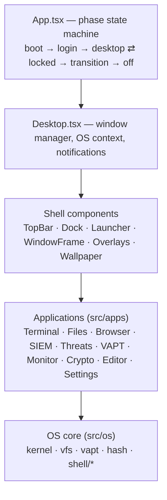
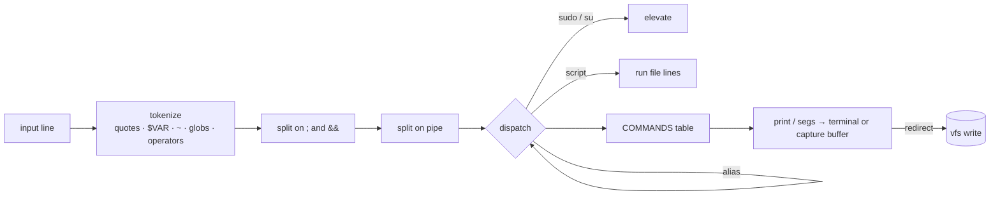

# 🏗️ Sugreev OS — Architecture

Sugreev OS is a **single-page React application** that emulates an operating system. It has **no backend**: the "kernel", file system, SIEM and VAPT engine are TypeScript modules running in the browser.

## 1. Layers



| Layer | Responsibility |
|---|---|
| `App.tsx` | Power/login state machine. Starts & stops the kernel. Persists settings. |
| `Desktop.tsx` | Owns the window list, z-order, notifications; exposes the **OS API** via `OSContext`. |
| `components/*` | Visual shell. `WindowFrame` implements drag / resize / min / max. |
| `apps/*` | Self-contained apps. Get their window id & props via `WinContext`. |
| `os/*` | Pure logic — no React except small `useSyncExternalStore` hooks. |

## 2. Kernel (`src/os/kernel.ts`)

A module-level store that ticks every second and publishes an immutable **snapshot** through `useSyncExternalStore`.

| Data | How it is produced |
|---|---|
| CPU (8 cores), frequency, temperature, load | Random-walk with drift, occasional spikes; temperature follows load |
| Memory, swap, disk, network | Smoothed noise + sine drift; network jumps during *attack surges* |
| Processes | Fixed base list + one `sgv-app-*` process per open window; CPU share normalised to total load |
| SIEM events | Weighted templates (`TEMPLATES`) → `LogEvent` with severity, source, MITRE technique, attacker IP/country |
| Alerts | Probabilistic promotion of events, de-duplicated by rule/IP/time, auto-triage of stale low-sev alerts |
| Threat level | Open alerts weighted by severity with **age decay** + surge bonus |
| Response | `blockIp`, `unblockIp`, `setAlertStatus`, `setAutoBlock`, `killProc` mutate the store |

Because the terminal (`siem`, `threats`, `ps`, `top`…), the SIEM app, the Threat Monitor and the top bar all read the **same snapshot**, a block issued in one place is instantly visible everywhere.

## 3. Virtual file system (`src/os/vfs.ts`)

- Tree of `FSNode { type, content, children, mode, owner, mtime }`
- Realistic default hierarchy: `/etc`, `/var/log`, `/home/vaibhav`, `/opt/sugreev`, `/proc`, `/root` …
- Linux-style permission checks (root-owned paths need `sudo`; `/root` and `/etc/shadow` are protected)
- Persisted to `localStorage` (debounced); `resetFs()` restores defaults
- `useFsVersion()` re-renders UI when anything changes

## 4. Shell (`src/os/shell/`)



| File | Content |
|---|---|
| `types.ts` | `ShellCtx`, `Cmd`, flag parser, formatting helpers |
| `sys.ts` | Files, text tools, system info, process, services, apt, desktop & power, fun |
| `sec.ts` | `nmap`, `vapt`, `nikto`, `searchsploit`, `cve`, `siem`, `threats`, network tools, firewall |
| `engine.ts` | Tokenizer, pipeline executor, `sudo`, scripts, `help`/`man`, tab completion |

**Async commands** (scans, `ping`, `siem tail -f`) use `ctx.sleep()`, which throws `ABORT` on **Ctrl+C**.

## 5. VAPT engine (`src/os/vapt.ts`)

1. `generateScan(target, profile)` hashes the target string into a seed (`mulberry32`).
2. Each service in the database is opened with a fixed probability; a **vulnerable** or **patched** version is chosen.
3. Findings reference **real public CVEs** (CVE-2011-2523, CVE-2014-0160, CVE-2017-0144, CVE-2021-41773 …) with CVSS, description and remediation.
4. Web-audit checks (headers, SQLi, XSS, exposed `.git` …) are generated per target.
5. `risk` score = weighted sum of severities. `buildReport()` renders Markdown.

Same target ⇒ same result, so lessons and screenshots are reproducible. `localhost` / `sugreev.local` return a hardened host.

## 6. Window management

- `Desktop` keeps `WinState[]` (`x y w h z min max props`)
- Focus = highest `z` among non-minimised windows
- `WindowFrame` is `memo`'d; apps are `memo`'d, so dragging one window does not re-render the others
- Singleton apps (SIEM, Threats, VAPT …) re-focus instead of opening twice; Terminal / Files / Browser / Editor are multi-instance

## 7. Styling

- Tailwind CSS 4 with `@theme inline` tokens (`--color-accent: var(--accent)`) → one CSS variable re-themes the entire OS
- Utility layer in `index.css`: `.glass`, `.btn`, `.inp`, `.tbl`, `.neon-text`, animations
- Fonts: Orbitron (display), JetBrains Mono (terminal/UI chrome), Inter (body)

## 8. Build output

`vite-plugin-singlefile` inlines JS and CSS → `dist/index.html` is **one portable file**.

## 9. Regenerating docs

```bash
mkdir -p .tmp
npx esbuild scripts/gen-commands.ts --bundle --platform=node --format=esm --outfile=.tmp/gen-commands.mjs
node .tmp/gen-commands.mjs     # rewrites docs/COMMANDS.md
```
